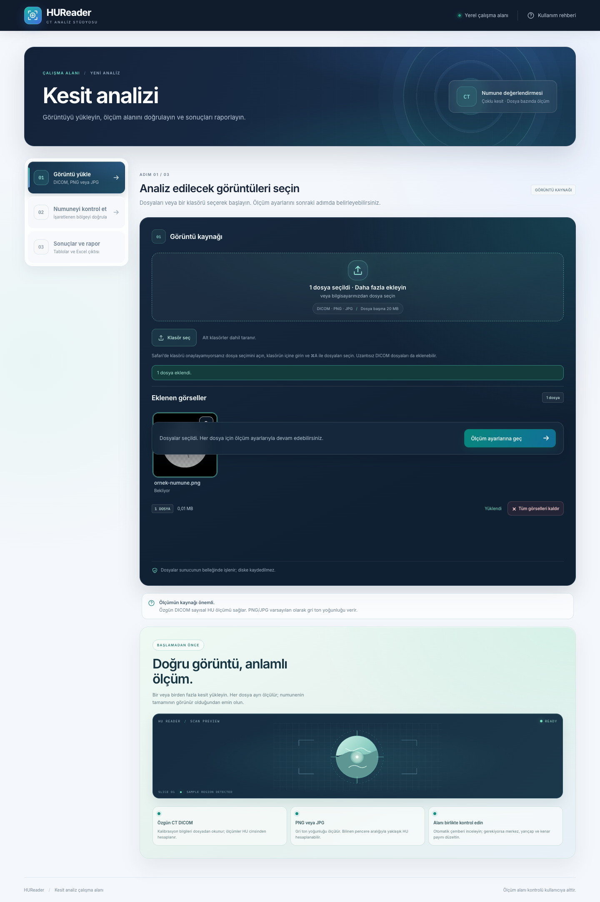
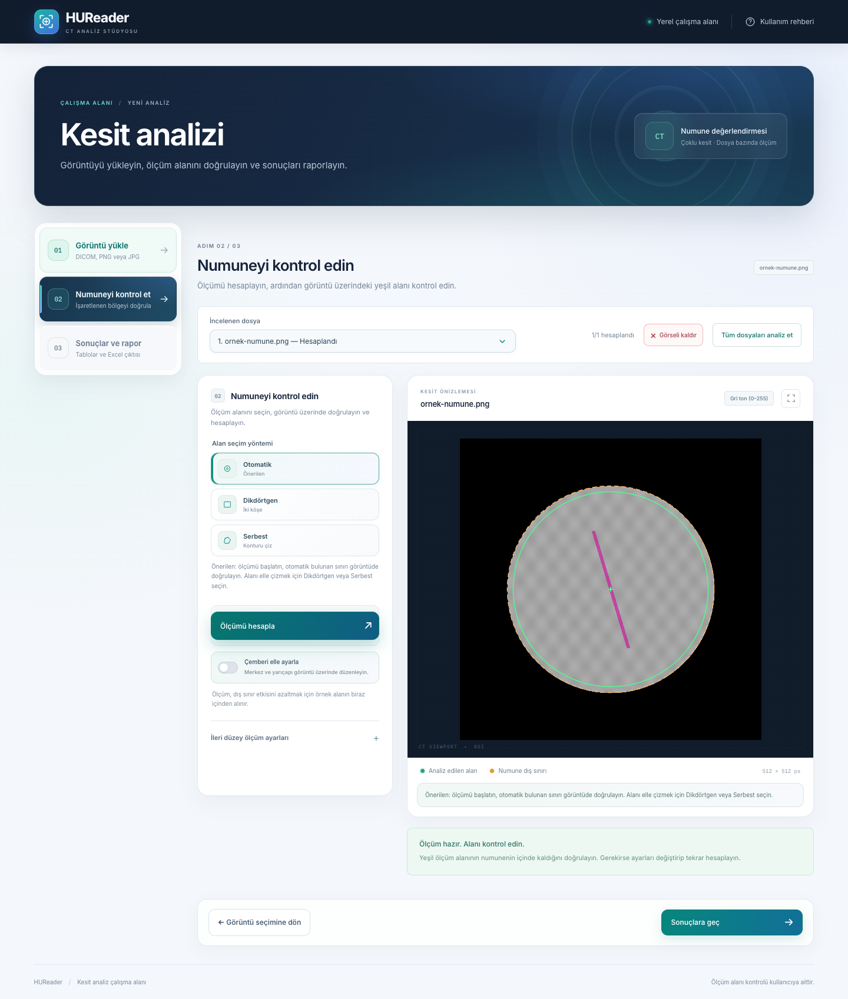
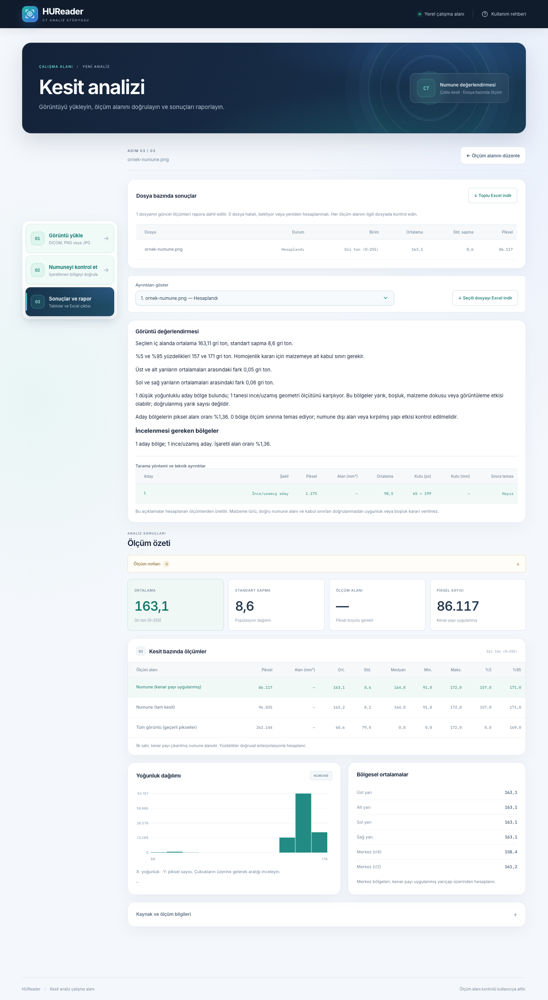
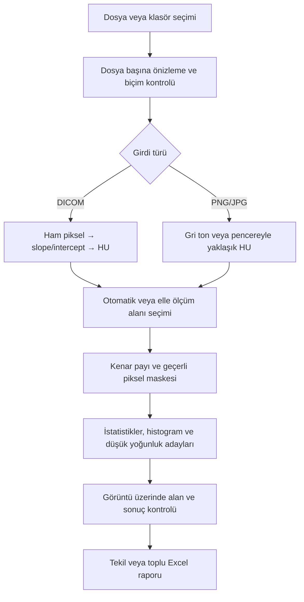

# HUReader

NestJS + TypeScript ile CT kesiti / numune görseli analiz uygulaması. Türkçe web arayüzü, dosya yükleme, dairesel ölçüm alanı, sayısal ölçümler, histogram ve Excel raporu içerir.

## İçindekiler

- [Ekran görüntüleri](#ekran-görüntüleri)
- [Çalıştırma](#çalıştırma)
- [Kullanım](#kullanım)
- [Kullanım metodolojileri](#kullanım-metodolojileri)
- [Alan seçimi ve sayısal değerlendirme](#alan-seçimi-ve-sayısal-değerlendirme)
- [Materyal referansı ve yarık adayları](#materyal-referansı-ve-yarık-adayları)
- [Ölçümler](#ölçümler)
- [Giriş biçimleri ve ölçüm birimleri](#giriş-biçimleri-ve-ölçüm-birimleri)
- [API](#api)
- [Doğrulama](#doğrulama)
- [Proje yapısı](#yapı)

## Ekran görüntüleri

Aşağıdaki görüntüler uygulamanın gerçek arayüzünden, sentetik bir PNG numune ile alınmıştır. Görünen değerler kullanım örneğidir; gerçek DICOM ölçümü veya kalibrasyon referansı değildir.

### 1. Görüntü yükleme

Tek dosya, çoklu dosya veya klasör seçerek analiz kuyruğu oluşturun.



### 2. Ölçüm alanını kontrol etme

Numune sınırını ve kenar payı uygulanmış iç ölçüm alanını görüntü üzerinde doğrulayın.



### 3. Sonuçlar ve Excel raporu

Sayısal ölçümleri, histogramı ve düşük yoğunluk adaylarını inceleyip raporu indirin.



## Çalıştırma

Projenin `package.json` dosyasındaki sürüm koşuluna uygun **Node.js 24.x** ve npm gerekir.

```bash
npm ci
npm run start:dev
```

http://localhost:3000 adresini açın. Portu değiştirmek için `PORT=4000 npm run start:dev` kullanın. `.env.example` değişkenleri gösterir; `.env` otomatik yüklenmez. Örneğin `MAX_IMAGE_PIXELS=33554432 npm run start:dev` sınırı 33.554.432 piksele yükseltir; `MAX_IMAGE_PIXELS=0 npm run start:dev` uygulama piksel sınırını kapatır.

Üretim derlemesini çalıştırmak için:

```bash
npm run build
npm run start:prod
```

`public/` klasörünü de dağıtıma dahil edin. Bu uygulama yerel kullanım için hazırlanmıştır; hesap, veri tabanı veya geçmiş kayıtları içermez. Yüklenen dosyalar sunucu belleğinde işlenir, diske yazılmaz.

## Kullanım

1. **Görüntü yükle:** Bir veya birden fazla PNG, JPG veya tek kesitli CT DICOM seçin. **Klasör seç** düğmesiyle bir klasörü alt klasörleriyle birlikte de ekleyebilirsiniz. Kuyrukta görseller önizleme kartlarıyla gösterilir; kartın sağ üstündeki çöp kutusu ilgili görseli kaldırır. **Ölçüm ayarlarına geç** ile ikinci aşamayı açın.
2. **Ölçüm alanını incele:** Dosya seçicisinden incelemek istediğiniz kesiti seçin. Alan seçiminde **Otomatik** önerilen yöntemdir; numune sınırı otomatik bulunur ve sonuçtan sonra görüntü üzerinde kontrol edilir. **Dikdörtgen** ile alanı sürükleyerek veya iki karşı köşeye tıklayarak, **Serbest** ile konturu sürükleyerek veya köşeleri sırayla seçerek belirleyebilirsiniz. Otomatik sınır uygun değilse bu yöntemlerden biriyle alanı çizin.
3. Otomatik daireyi elle düzenlemek için **Çemberi elle ayarla** seçeneğini açın. Kesikli turuncu numune sınırını ve yeşil ölçüm alanını doğrulayın; gerekirse merkez, yarıçap, piksel boyutu ve kenar payını değiştirip yeniden hesaplayın. **Ölçümü hesapla** yalnızca seçili dosyayı, **Tüm dosyaları analiz et** güncel sonucu olmayan dosyaları sırayla işler. Her dosya kendi ayarlarını korur; bir dosya hata verdiğinde sıradaki dosyaya geçilir.
4. **Sonuçlara geç** ile üçüncü aşamayı açın. En az bir güncel başarılı ölçüm varsa bu aşama kullanılabilir. Üstte tüm dosyaların durumu ve karşılaştırma tablosu, altta seçilen başarılı dosyanın ayrıntıları görünür. **Excel raporunu indir** seçilen dosyanın dört sayfalı raporunu, **Toplu Excel indir** tüm güncel başarılı sonuçların altı sayfalı raporunu üretir.

Üstteki sekmeler ve geri düğmeleriyle önceki aşamalara dönebilirsiniz. Aynı dosya için ayarlar korunur. Dosya seçilmeden ikinci, en az bir başarılı hesaplama yapılmadan üçüncü aşama açılmaz. Bir dosyanın ayarları değişirse o dosyanın eski ölçümü toplu tablodan ve Excel ölçümlerinden çıkarılır; diğer dosyaların güncel sonuçları korunur. Yeni eklenen dosyalar boş ayarlar ve otomatik alan seçimiyle başlar. Dosyalar sırayla, tek dosyalı analiz API’si üzerinden işlenir; istek başına tek dosya sınırı toplu dosya seçimini engellemez. Kuyruk ve sonuçlar yalnızca açık tarayıcı sekmesinde tutulur; sayfa yenilendiğinde temizlenir.

Klasör seçiminde PNG/JPG, `.dcm`/`.dicom`/`.ima` dosyaları ve başlığında DICOM Part 10 imzası bulunan uzantısız/sayısal uzantılı dosyalar tanınır. Diğer biçimler ve gizli dosyalar atlanır; eklenen, atlanan ve zaten listede olan dosya sayıları gösterilir. Aynı göreli yol, boyut ve son değiştirme bilgisine sahip dosyalarda içerik de SHA-256 ile karşılaştırılır; yalnızca içerik de aynıysa tekrar seçim kuyruğa eklenmez. Aynı metadata ile farklı içerikler ayrı tutulur. Okunamayan dosya klasörün kalanının eklenmesini durdurmaz. Dosyalar göreli yola göre doğal sırada listelenir. Alt klasörlerde aynı adı taşıyan dosyalar ayrı tutulur; yollar önizlemede, karşılaştırma tablosunda ve her iki Excel raporunda korunur.

Klasör seçimi tarayıcının kullanıcı tarafından seçilen dosyalarına dayanır; sunucuya mutlak bir disk yolu verilmez. Seçim anlık bir taramadır, klasör izleme hizmeti değildir. Yeni dosyalar eklenince klasörü tekrar seçin. Klasör seçimini desteklemeyen tarayıcılarda çoklu dosya seçimi kullanılabilir. Tarayıcı özelliği: [MDN — webkitdirectory](https://developer.mozilla.org/en-US/docs/Web/API/HTMLInputElement/webkitdirectory).

Sekmeler sol/sağ ok, Home ve End tuşlarıyla kullanılabilir. Önizlemedeki tam ekran düğmesiyle kesiti büyütebilir, **Kullanım rehberi** düğmesiyle kısa açıklamaları açabilirsiniz. Ölçüm notları sonuçlar bölümünde açılıp kapatılabilir. Arayüz masaüstü ve mobil ekranlara uyarlanır.

## Kullanım metodolojileri

### Yöntem seçimi

| Amaç | Önerilen girdi ve yöntem | Sonucun yorumu |
| --- | --- | --- |
| Bir kesitte nicel CT analizi | Özgün, desteklenen DICOM; otomatik alanı kontrol ederek ölçüm | DICOM dönüşümünden hesaplanan HU; PixelSpacing varsa mm² |
| Düzensiz numuneyi ölçme | Otomatik sınırı inceleyin; gerekirse dikdörtgen veya serbest çokgen çizin | Seçilen iç alanın istatistikleri; dairesel merkez bölgeleri uygulanmaz |
| Ekran görüntüsünü ön değerlendirme | PNG/JPG; biliniyorsa piksel boyutu ve pencere sınırlarını girin | Kalibrasyonsuz 0–255 gri ton, pencere dönüşümüyle yaklaşık HU |
| Birden fazla kesiti karşılaştırma | Çoklu dosya veya klasör; her dosyanın alanını doğrulayın, toplu analiz yapın | Aynı birim ve benzer çekim/alan koşullarındaki sonuçları karşılaştırın |
| Koyu veya ince bölgeleri araştırma | Doğrulanmış iç alan; otomatik ya da kullanıcı tanımlı düşük yoğunluk eşiği | İncelenecek aday bölgeler; kesin yarık veya porozite kararı değildir |

### 1. Tek kesitte tekrarlanabilir ölçüm

1. Mümkünse işaretlenmemiş özgün DICOM dosyasını yükleyin. PNG/JPG kullanıyorsanız birimin gri ton veya yaklaşık HU olacağını dikkate alın.
2. **Ölçüm ayarlarına geç** ile kesiti açın ve **Ölçümü hesapla** düğmesine basın. Otomatik sınırı görüntü üzerinde kontrol edin.
3. Sınır numuneyi doğru kapsamıyorsa alanı elle çizin. Daire, dikdörtgen veya serbest seçimde arka planı ve ilgisiz parçaları dışarıda bırakın.
4. Kenar payını kontrol edin. Karşılaştırmalı çalışmalarda aynı fiziksel kenar payını kullanın; piksel boyutu bilinmiyorsa piksel cinsinden ayarı kaydedin.
5. Alanı veya ayarları değiştirdiğinizde yeniden hesaplayın. **Sonuçlara geç** ile ortalama, standart sapma, yüzdelikler ve bölgesel farkları değerlendirin.
6. **Excel raporunu indir** ile ölçümleri ve işaretli görüntüyü birlikte saklayın. Kaynak dosyayı da ayrı koruyun; uygulama geçmiş tutmaz.

### 2. Klasör ve çoklu kesit karşılaştırması

1. **Klasör seç** veya çoklu dosya seçimiyle kesitleri ekleyin; göreli yolları ve dosya sırasını kontrol edin.
2. Her dosyayı açarak alanını doğrulayın. Bir dosyanın ayarı diğerlerine otomatik aktarılmaz.
3. **Tüm dosyaları analiz et** ile güncel sonucu olmayan dosyaları işleyin. Hatalı dosyaları düzeltip yeniden deneyin.
4. Sonuç tablosunda önce birimleri kontrol edin. HU, yaklaşık HU ve gri ton değerlerini aynı ölçüm serisi gibi yorumlamayın. Çekim koşulları, numune ve alan seçiminin de karşılaştırılabilir olması gerekir.
5. **Toplu Excel indir** ile güncel başarılı sonuçları dışa aktarın; eksik, hatalı veya eski sonuçlar için **İşlem Durumu** sayfasını inceleyin.

Bu akış kesit bazında karşılaştırma sağlar; kesitleri birleştirerek 3B hacim veya hacimsel porozite hesaplamaz. Sayfayı yenilemeden önce raporu indirin.

### 3. Düşük yoğunluk ve yarık adaylarını inceleme

1. Önce ölçüm alanını doğrulayın; sınırın dışındaki pikseller aday taramasına katılmaz.
2. İlk incelemede otomatik eşiği kullanın. Malzemeye özgü doğrulanmış bir eşik varsa **Gelişmiş ayarlar** üzerinden girin; eşik sonuçla aynı birimdedir.
3. Pembe aday katmanını özgün önizlemeyle karşılaştırın. Alan sınırına değen bölgeleri, küçük bölgeleri ve olası artefaktları ayrıca inceleyin.
4. Aday sayısını, alan oranını ve uzamış adayları raporlayın. Kapsayan kutunun ölçülerini gerçek yarık genişliği/uzunluğu olarak kullanmayın.
5. Malzeme uygunluğu veya kesin yarık kararı için bağımsız referansla değerlendirin. Eşik, alan ve kaynak görüntüyü raporla birlikte koruyun.

### 4. Hesaplamadan önce boşluk sınırlarını düzeltme

1. Ölçüm ayarları aşamasında **Boşluk ön analizi** düğmesine basın. Bu işlem adayları hazırlar; ön analiz tek başına rapor aşamasını açmaz.
2. Görüntüdeki **×** simgesiyle yanlış adayı kaldırın. Bir boşluğu seçip beyaz sınır noktalarını sürükleyerek şeklini her yönde değiştirin.
3. Seçili boşluğun kenarına tıklayarak yeni nokta ekleyin ve sürükleyin. Sınır standart bir şekle bağlı değildir; içbükey çokgenler desteklenir. Nokta odaktayken **Delete/Backspace** noktayı siler. En az 3, en fazla 512 nokta kullanılabilir.
4. **Escape** devam eden hareketi iptal eder; **Geri al** son düzenlemeyi, **Düzeltmeleri sıfırla** tüm düzenlemeleri geri alır. Kendi üzerinden geçen veya alanı sıfır olan sınırlar kabul edilmez.
5. **Ölçümü hesapla** ile düzeltmeleri onaylayın. Aday sayısı, alanı, oranı ve aday ortalamaları düzenlenen maskeden yeniden hesaplanır; Excel'deki işaretli görüntü ve aday bilgileri de güncellenir. Genel numune yoğunluğu istatistikleri aynı ölçüm alanından hesaplanmaya devam eder.

Düzeltmeler dosyaya özeldir ve yalnızca açık sekmede tutulur. Ölçüm alanı dışındaki pikseller aday hesabına alınmaz; çakışan alanlar bir kez sayılır. Düzenlenmeyen adayların özgün piksel maskesi korunur. En büyük 50 aday düzenlenebilir; diğer adaylar toplam ölçümde korunur. Ölçüm alanı, eşik veya kalibrasyon değişirse eski düzeltmeler sıfırlanır; ön analizi yeniden çalıştırın. **Ön analizi yenile (sıfırla)** da mevcut düzeltmeleri temizler.

### Ölçümün hesaplanma akışı



## Alan seçimi ve sayısal değerlendirme

Standart akışta teknik ayar girmek gerekmez. Sınır bulanıklığını azaltan içeri alma mesafesi ve koyu bölge tarama eşiği otomatik belirlenir. Piksel mesafesi, eşik ve kalibrasyon alanları kapalı “Gelişmiş ayarlar” bölümündedir. Elle alan düzeltmesi açılınca hassas koordinat ayarları görünür. Daireye ek olarak dikdörtgen ve serbest çokgen seçilebilir. Ölçüm ayarlarında şekli seçin; dikdörtgen için iki karşı köşeye, çokgen için sınır boyunca en az üç noktaya tıklayın. Köşeler en yakın piksel koordinatına oturtulur. Çokgen en fazla 128 köşelidir; kendini kesen veya alanı sıfır seçimler reddedilir. Her dosyanın şekli ve köşeleri ayrı korunur. Otomatik analiz önce daireyi dener; uygun daire yoksa şekilden bağımsız ön plan ayrımı ve içbükey sınır izleme kullanır. Açık/koyu arka plan, döndürülmüş/düzensiz ve çok parçalı numuneler aynı akışa girer. Kapalı iç boşluklar, düşük yoğunluk ölçümü için korunur; masa ve ince destek adayları elenir. Birden fazla parça bulunursa hem birleşik hem ayrı değerler raporlanır. Güvenilir öneri yoksa alanın görüntü üzerinde çizilmesi istenir. [60 gerçek dosya için genel akış doğrulaması](docs/general-analysis-validation-2026-11-02.md).

Otomatik düzensiz parçalarda varsayılan içeri alma mesafesi gerçek siluetin iç açıklığıyla sınırlanır; dar parçaların tamamen silinmesi önlenir. Elle girilen mesafe değiştirilmez. Kenar payı, çokgen/dikdörtgen içinde en yakın kenara olan Öklid uzaklığıyla uygulanır. Geçerli piksel merkezleri kullanılır; bu nedenle alan, sürekli çokgen alanından küçük bir miktar farklı olabilir. Anizotropik piksellerde fiziksel kenar payı küçük piksel boyutuna göre piksele çevrilir ve uyarı verilir. Üst/alt ve sol/sağ bölgeler şeklin sınırlayıcı kutusunun merkeziyle ayrılır; r/4 ve r/2 merkez bölgeleri yalnızca daire içindir, diğer şekillerde boş gösterilir. Yeşil sınır hesaplanan gerçek iç piksel maskesini gösterir.

Sayısal değerlendirme ortalama, standart sapma, yüzdelikler ve yarılar arasındaki farkları açıklar. İsteğe bağlı düşük yoğunluk eşiği, eşik ve altındaki geçerli piksel oranını verir. Bu alan oranı, doğrulanmış porozite veya hacimsel boşluk ölçümü değildir. Homojenlik/uygunluk kararı için malzeme ve kabul sınırları gerekir. Dosyalar arasındaki aralık yalnızca aynı birimlerde sunulur; aynı numune, çekim ve alan koşulları ayrıca doğrulanmalıdır. DICOM ImageType içindeki türetilmiş/yeniden formatlanmış/ortalama/izdüşüm etiketleri sonuçlarda uyarı olarak gösterilir. Açıklamalar sayısal kurallardan üretilir; harici yapay zekâ servisine görüntü gönderilmez.

## Materyal referansı ve yarık adayları

Standart arayüz materyal referansı seçtirmez; her görüntü kendi piksellerinden analiz edilir. Paylaşılan Excel, ölçüm yönteminin referansıdır. İsteğe bağlı `materialReference=marble-excel` API parametresi geriye dönük karşılaştırma için korunmuştur; arayüz bu parametreyi göndermez. Referansın kenar paylı örnek ortalaması −238,5 HU, standart sapması 400 HU'dur. Bunlar yeni görüntüye dayatılan hedefler veya kabul sınırları değildir; yeni sonuçlar her dosyanın kendi DICOM piksellerinden hesaplanır. Karşılaştırma yalnızca gerçek HU sonuçlarında sunulur. Görüntü türü türetilmiş/ortalama/izdüşüm ise farkların doğrudan eşdeğer değerlendirilemeyeceği belirtilir.

Düşük yoğunluk aday taraması yalnızca seçilen iç alandaki geçerli piksellere uygulanır. Kullanıcı eşik belirtmediyse `medyan − max(1, 3 × 1,4826 × MAD)` kullanılır; MAD, medyandan mutlak sapmaların medyanıdır. Bu keşif amaçlı bir eşik önerisidir, mermer için kalibre edilmiş yarık eşiği değildir. Sekiz komşulukla bağlı en az üç piksellik bölgeler aday kabul edilir. Fiziksel piksel boyutlarıyla hesaplanan ikinci moment eksen oranı en az 3 olan ve piksel kutusunun uzun kenarı en az 6 piksel olan bölgeler “ince/uzamış aday” olarak ayrılır. 1/2 piksellik bölgeler gürültü bastırma amacıyla sayılmaz. Ölçüm alanı sınırına değen bölgeler ayrıca işaretlenir.

Aday sayısı, piksel alanı ve oranı, varsa mm² alan, ortalama, kapsayan kutunun piksel/mm boyutları raporlanır. Kutunun boyutu gerçek yarık genişliği veya uzunluğu değildir. Pembe katman aday pikselleri gösterir; yalnızca görünümü açıp kapatmak ölçümü değiştirmez. En büyük 50 bölge tabloda listelenir; toplamlar ve görüntü katmanı tüm adayları kapsar. Tekil ve toplu Excel'e işaretli görüntü ve aday bilgileri eklenir.

Bu yöntem gözenek, mineral/doku değişimi, kısmi hacim etkisi ve artefaktları yarıktan kesin ayıramaz. Bulunmayan bir aday, yarık bulunmadığını kanıtlamaz; aday alan oranı 3B porozite değildir. Etiketli sağlam/yarıklı referans kesitler olmadan duyarlılık/özgüllük veya doğruluk yüzdesi iddia edilmez. Harici görsel yapay zekâ modeli henüz kullanılmıyor.

## Görüntü üzerinde sürükleyerek seçim

Normal modda görüntüye basılı tutup sürüklemek dikdörtgen seçim başlatır. Düzensiz modda sürükleyerek serbest sınır çizilebilir; köşelere tek tek tıklama da korunmuştur. Daireyi elle düzenlerken merkezden dışarı sürüklenir; boş yarıçapla görünmez seçim oluşmaması için başlangıç dairesi hazırlanır. Sınır ve yarı saydam turuncu dolgu sürükleme sırasında görünür. Gösterim katmanı özgün görüntü piksellerini değiştirmez. Görsel dışına taşan sürükleme görüntü içinde sınırlanır; Escape yeni çizimi iptal ederek önceki seçimi geri getirir. Serbest çizim en fazla 128 köşeye indirgenir, kendini kesen alanlar analizde reddedilir.

## Ölçümler

- Kenar payı uygulanmış numune, tam numune ve tüm geçerli görüntü için piksel sayısı, alan, ortalama, popülasyon standart sapması, medyan, minimum, maksimum ve %5/%95 yüzdelikleri.
- İç ölçüm alanında üst/alt ve sol/sağ yarılar; iç yarıçapın 1/4 ve 1/2 merkez bölgeleri.
- Kenar payı uygulanmış numune histogramı. Sınıflar alt sınırı dahil, üst sınırı hariç olacak şekilde oluşturulur. Tüm ölçüm pikselleri kapsanır.
- Yüzdelikler sıralı veride doğrusal enterpolasyonla hesaplanır. Boş bölgeler sıfır yerine boş değer döndürür.
- Alan = geçerli piksel sayısı × piksel boyutu X × piksel boyutu Y. Piksel boyutu bilinmiyorsa mm² hesaplanmaz.

## Giriş biçimleri ve ölçüm birimleri

**DICOM:** Part 10 başlığı olan, tek kareli, tek kanallı, sıkıştırılmamış 8/16 bit CT desteklenir. Implicit VR Little Endian, Explicit VR Little Endian ve Explicit VR Big Endian kabul edilir. HU = ham piksel × RescaleSlope + RescaleIntercept. DICOM PixelSpacing ve PixelPadding bilgileri kullanılır; hasta kimlik bilgileri sonuçlara taşınmaz. Desteklenmeyen sıkıştırma, çok kare, LUT ve HU dışı birim durumları açık hata verir. RescaleType yoksa CT modalitesine dayanıldığı raporda belirtilir. Yalnızca tek, klasik CT kesiti desteklenir; Enhanced CT desteği yoktur.

**PNG/JPG:** EXIF yön bilgisi uygulanarak önizlemeyle aynı koordinat yönünde işlenir. Siyah arka plan üzerine düzleştirilmiş, 8 bit gri ton yoğunluğu (0–255) analiz edilir. Bu değerler HU değildir. Bilinen pencere alt/üst sınırları birlikte girilirse doğrusal dönüşümle **yaklaşık HU** gösterilir. Pencere dönüşümünün doğrusal olduğu varsayılır; kayıplı sıkıştırma, gama/renk dönüşümleri, pencere uçlarında kırpılma, yeniden boyutlandırma ve görüntü üzerindeki işaretler nedeniyle özgün DICOM sonuçları elde edilemez. Tam sayısal analiz için işaretlenmemiş özgün DICOM gerekir.

PNG/JPG piksel boyutu isteğe bağlı girilir. DICOM'da kullanıcı piksel boyutu ve pencere kalibrasyonu alanları kullanılmaz; dosyadaki değerler esastır. DICOM önizlemesi −1000 … +1000 HU aralığındadır, ölçümler bu görüntüleme aralığıyla kırpılmaz.

Varsayılan kenar payı: piksel boyutu varsa 2,1 mm, yoksa 10 piksel. Çember piksel koordinatlarındadır; anizotropik piksellerde kenar payı küçük piksel boyutuna göre hesaplanır ve uyarı gösterilir. Kullanıcı özel kenar payını piksel cinsinden belirleyebilir.

Girdi sınırları: dosya başına 20 MB, varsayılan 16.777.216 piksel (4096 × 4096), istek başına bir dosya. Piksel sınırı zorunlu değildir: `MAX_IMAGE_PIXELS` ortam değişkeniyle değiştirilebilir; `0` uygulamanın piksel sınırını kapatır. Görüntüler küçültülmeden, özgün çözünürlükte analiz edilir. Daha büyük görüntüler daha fazla bellek ve işlem süresi gerektirir. Dosya boyutu sınırı piksel sınırından bağımsızdır. Çember görüntü içinde olmalıdır. Rastgele şekiller, dikdörtgen numuneler ve numunenin görünmediği kesitler için otomatik daire seçimi uygun değildir.

Örnek Excel `Z01_CT_Sayilari.xlsx` bir çıktı referansı olarak kullanıldı. Dosyadaki ölçümler kodda sabit değildir; her yükleme kendi piksel verisinden hesaplanır. Excel'e gömülü PNG ile orijinal DICOM tablosundaki değerlerin birebir yeniden üretilmesi beklenmemelidir.

## API

- `POST /api/preview`: `multipart/form-data`, `file` alanı. Ölçüm alanı seçmeden PNG önizlemesi, boyut ve birim bilgisi döndürür. Otomatik çember bulunamayan DICOM dosyaları da önizlenebilir.
- `POST /api/defects/preview`: Aynı dosya ve ölçüm ayarlarıyla düzenlenebilir boşluk ön analizi döndürür; önizleme, ROI ve aday maskesi içerir, nihai ölçüm tablosu içermez.
- `POST /api/analyze`: `multipart/form-data`, `file` alanı ve isteğe bağlı ölçüm ayarları. JSON sonuç döndürür.
- `POST /api/export`: Aynı dosya ve ayarları alır; XLSX raporu döndürür.
- `GET /health`: `{ "status": "ok" }`.

İsteğe bağlı alanlar:

| Alanlar | Açıklama |
| --- | --- |
| `defectEdits` | JSON `[{"id":1,"points":null}]` adayı siler; `points:[[x,y],...]` sınırı değiştirir. Kimlikler ön analizdeki adaylara aittir; en fazla 50 düzenleme, çokgen başına 3–512 nokta. |
| `roiShape` | `circle` (varsayılan), `rectangle`, `polygon` |
| `roiPoints` | JSON `[x,y]` dizisi; dikdörtgen için iki karşı köşe, çokgen için 3–128 köşe |
| `materialReference` | `marble-excel` veya `none`; hesaplanan HU değiştirilmez |
| `lowDensityThreshold` | İsteğe bağlı eşik; birimi sonuçla aynıdır, eşik ve altı sayılır |
| `sourcePath` | İsteğe bağlı göreli dosya yolu; yalnızca sonuç/rapor etiketi olarak kullanılır |
| `centerX`, `centerY`, `radius` | Elle ROI; üçü birlikte, piksel cinsinden |
| `insetPixels` | Sıfır veya pozitif kenar payı |
| `spacingX`, `spacingY` | PNG/JPG için pozitif mm/piksel değerleri; birlikte |
| `windowMin`, `windowMax` | PNG/JPG için yaklaşık HU dönüşümü; birlikte |

Tek dosyalı rapor sayfaları: **CT Sayıları**, **DICOM Bilgileri**, **Histogram (Numune)**, **Ölçüm Alanı**. Son sayfada işaretli kesit önizlemesi bulunur. PNG/JPG raporlarında DICOM Bilgileri sayfası yalnızca mevcut kaynak ve kalibrasyon bilgilerini içerir.

Toplu rapor sayfaları: **CT Sayıları**, **Bölgesel Ortalamalar**, **Kaynak Bilgileri**, **Histogram (Numune)**, **Ölçüm Alanı**, **İşlem Durumu**. Her satır dosya sırası ve adıyla ilişkilidir; HU, yaklaşık HU ve gri ton değerleri birim sütununda ayrı belirtilir. Hatalı, bekleyen ve güncelliğini kaybeden dosyalar yalnızca durum sayfasında listelenir. Alan sayfasında her başarılı dosyanın işaretli önizlemesi bulunur. Toplu Excel, tekrar yükleme veya analiz yapmadan tarayıcıdaki güncel sonuçlardan ExcelJS ile hazırlanır; paket yerel sunucudaki `/vendor/exceljs.min.js` adresinden yüklenir.

## Doğrulama

```bash
npm run build
npm run lint
npm test
npm run test:e2e
npm run test:workflow
```

Tarayıcı testleri Google Chrome kullanır ve kendi sunucusunu 3100 portunda başlatıp kapatır. Chrome yerine Playwright Chromium kullanmak için önce `npx playwright install chromium`, sonra `PLAYWRIGHT_CHANNEL=chromium npm run test:workflow` çalıştırın. Safari’nin WebKit motoruyla kontrol için `npx playwright install webkit`, ardından `PLAYWRIGHT_BROWSER=webkit npm run test:workflow` kullanın. Test portu `WORKFLOW_TEST_PORT` ile değiştirilebilir. Hata ekranları ve izler, Git'e alınmayan `test-results/` dizininde tutulur. Test verileri sentetiktir; kullanıcının dosyaları kullanılmaz.

[Akış denetimi ve bulunan hatalar](docs/flow-audit.md) dosyasında senaryolar, sayısal karşılaştırmalar ve doğrulamanın sınırları açıklanır.

Testler bilinen sayısal istatistikleri, sentetik daire seçimini, gri ton / yaklaşık HU ayrımını, DICOM signed piksel dönüşümünü, padding dışlamasını, alan hesabını, geçersiz girdi hatalarını ve gerçek XLSX üretimini doğrular. HTTP testleri geçici yerel port açar.

Ek olarak Chrome’da çoklu dosya seçimi, bağımsız ROI ve kalibrasyon ayarları, hata izolasyonu, tek dosya yeniden denemesi, toplu Excel’de birim/sayfa/önizleme doğruluğu, eski ölçümlerin dışlanması ve 320–1440 px genişliklerde üç aşamalı akış kontrol edildi. Klasör seçimi ayrıca gerçek iç içe test klasörüyle; uzantısız DICOM, aynı adlı dosyalar, filtreleme, tekrar seçim ve Excel yol bilgileri açısından doğrulandı. Paylaşılan 60 gerçek DICOM dosyasında bağımsız piksel ve istatistik doğrulaması [ayrı raporda](docs/dicom-validation-2026-11-02.md) bulunur; bu rapor önceki dairesel alan sürümüne aittir. Malzeme için bilinen fiziksel referans ölçümler sağlanmadığından cihaz kalibrasyonu veya bilimsel kabul doğrulaması yapılmadı.

## Yapı

- `public/`: Türkçe web arayüzü, canvas önizlemesi ve histogram.
- `src/analysis/`: Dosya çözümleme, ölçüm hesapları, yükleme API'si ve Excel üretimi.
- `test/`: HTTP testleri ve bellekte oluşturulan DICOM test verisi.

Kullanılan temel paketler: [NestJS](https://docs.nestjs.com/), [sharp](https://sharp.pixelplumbing.com/), [dicom-parser](https://github.com/cornerstonejs/dicomParser), [ExcelJS](https://github.com/exceljs/exceljs). ExcelJS'in dolaylı `uuid` bağımlılığı güvenlik düzeltmesi içeren 11.x sürümüne sabitlenmiştir; XLSX üretimi bu sürümle test edilmiştir.

### Otomatik alan seçiminin doğrulanması

Genel akış, sentetik farklı şekillerle ve 60 gerçek DICOM ile test edilmiştir. Güncel kapsam, dosya bazındaki sonuçlar ve sınırlamalar [genel doğrulama raporunda](docs/general-analysis-validation-2026-11-02.md) yer alır. Sayısal doğruluk ile alanın doğru numuneyi seçmesi ayrı doğrulamalardır.

### İşlem sayfaları ve route yönetimi

Yükleme, analiz ve rapor sayfaları sırasıyla `#/upload`, `#/analyze`, `#/report` adreslerini kullanır. Ortak `public/router.js` yöneticisi tarayıcının geri/ileri hareketlerini ve doğrudan adres değişikliklerini işler; sunucuda ek route tanımı gerekmez. Yeni bir sayfa için `public/app.js` içindeki `workflowRoutes` listesine `path`, `step`, gerekirse `canEnter` ve `redirect` eklenir; ilgili panel ve gezinme kontrolleri arayüzde tanımlanır.

Route geçişleri dosyaları, ayarları ve sonuçları bellekte korur. Dosyası olmayan analiz adresi yüklemeye, güncel sonucu olmayan rapor adresi analize yönlendirilir. Dosyalar silindiğinde mevcut adres de güncellenir. İşlem veya dosya aktarımı sürerken sayfa geçişi engellenir. Sayfa yenileme ve sekmeyi kapatma kalıcı kayıt sağlamaz; veri yoksa uygun başlangıç sayfası açılır.
